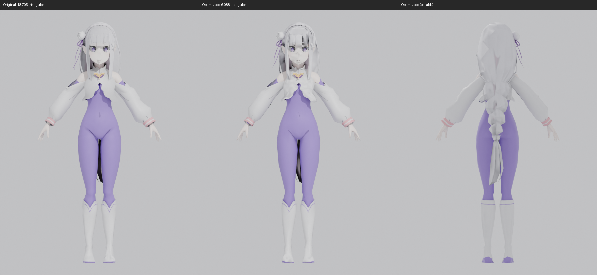

# Emilia para Falco azul (Smash Bros. Melee)

Modelo de Emilia (Re:Zero, versión con mono morado) preparado para importarlo
como skin del traje **azul de Falco** (`PlFcBu.dat`).

Modelo original: "Emilia Re:Zero 3D model" de aliensarereal12 (DeviantArt).



## Qué hay aquí

| Archivo | Qué es |
| --- | --- |
| `emilia_melee.fbx` | Modelo optimizado, listo para riggear e importar |
| `emilia_melee.blend` | El mismo modelo en Blender |
| `textures/` | Texturas reducidas a tamaños potencia de 2 (64–256 px) |
| `preview/comparacion.png` | Original y optimizado, de frente y de espalda |
| `tools/` | Scripts de Blender (`bpy`) para regenerar todo |

## Qué se ha hecho

- **Triángulos:** de 18.705 a 6.088 (decimado por pieza; los ojos, las cejas y el broche están sin tocar).
- **Shape keys** (expresiones de la cara) eliminados: Melee no los usa.
- **Texturas** reducidas de hasta 1254 px a 64–256 px, para que quepan en la memoria del personaje.
- Material duplicado de los accesorios del pelo unificado; un material sin textura se ha dejado en color plano.
- Modelo centrado y con los pies en el suelo (Y arriba en el FBX).

## Lo que falta

El modelo **no tiene esqueleto**. Para que se mueva como Falco hay que:

1. **Riggearlo al esqueleto de Falco:** sacar el esqueleto de `PlFcBu.dat`,
   escalar y alinear a Emilia con él y asignar los pesos (copiándolos del
   modelo de Falco o con pesos automáticos).
2. **Importarlo con HSDRaw** sobre `PlFcBu.dat` (Import Model From File),
   usando las texturas de `textures/`.
3. **Meter el `.dat` en la ISO** con DAT Texture Wizard, sustituyendo solo
   `PlFcBu.dat`.

Para el paso 1 hace falta el archivo `PlFcBu.dat` original. Se exporta desde
la ISO sin mods con DAT Texture Wizard (Disc File Tree → clic derecho → Export).

## Regenerar

```bash
pip install bpy pillow
python tools/optimize.py -- "ruta/Emilia.fbx" carpeta_salida
python tools/render_prev.py -- carpeta_salida/emilia_melee.fbx preview
```
