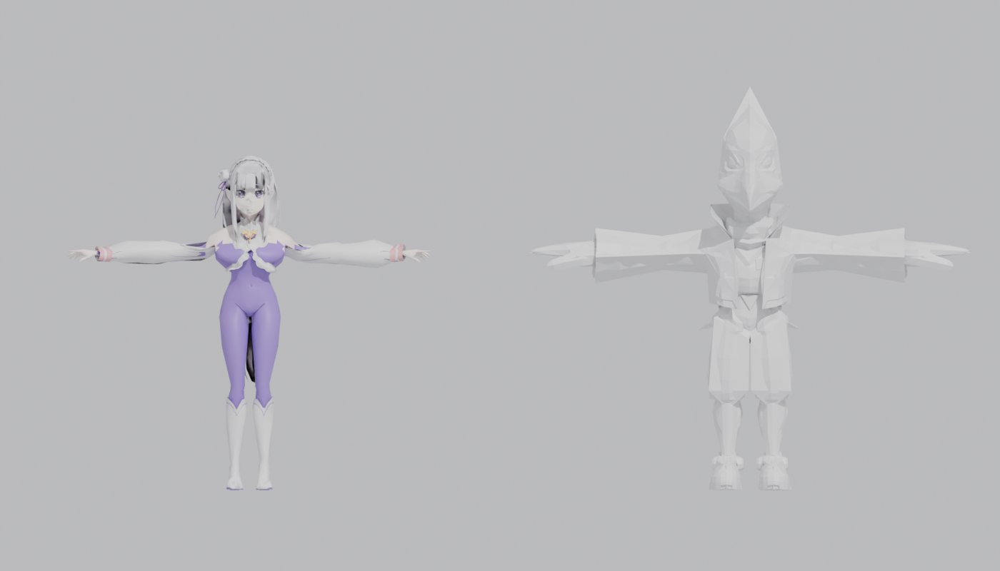
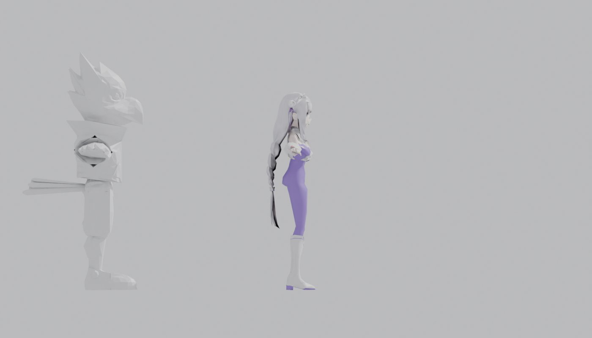
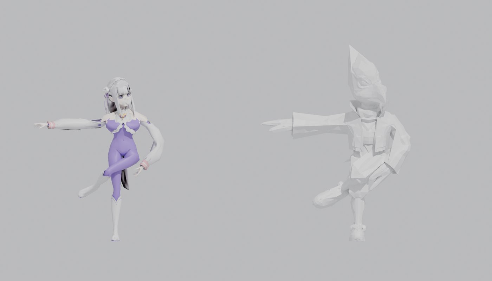

# Emilia para Falco azul (Smash Bros. Melee)

Modelo de Emilia (Re:Zero, versión con mono morado) **ya encajado y con huesos
asignados al esqueleto de Falco**, listo para importarlo con HSDRaw sobre el
traje azul de Falco (`PlFcBu.dat`).

Modelo original: "Emilia Re:Zero 3D model" de aliensarereal12 (DeviantArt).

| Pose T (como Falco) | Lado | Prueba de animación |
| --- | --- | --- |
|  |  |  |

En la prueba de animación se giran los mismos huesos de las dos (hombro, codo,
muslo, rodilla y cabeza) y Emilia se dobla igual que Falco.

## Archivos

| Archivo | Qué es |
| --- | --- |
| `rig/emilia_falco.smd` | **El que hay que importar en HSDRaw.** Esqueleto exacto de Falco (`JOBJ_0`…`JOBJ_66`) y Emilia con sus pesos |
| `rig/*.png` | Texturas que usa el `.smd` (tienen que estar en la misma carpeta) |
| `rig/emilia_falco.fbx` | Lo mismo en FBX, por si HSDRaw da problemas con el SMD |
| `rig/emilia_falco.blend` | Escena de Blender con el esqueleto de Falco y Emilia, para retocar pesos |
| `emilia_melee.fbx` / `.blend` | Modelo optimizado sin huesos (paso anterior) |
| `tools/` | Scripts para regenerarlo todo (Blender `bpy` + Pillow) |

## Qué se ha hecho

1. **Optimización:** de 18.705 a 6.088 triángulos (Falco tiene 5.585), sin
   shape keys y con texturas de 64–256 px.
2. **Lectura de `PlFcBu.dat`:** `tools/hsd.py` lee la jerarquía de huesos, las
   mallas y los pesos de Falco. El esqueleto tiene 67 huesos, en pose T.
3. **Encaje en la pose T de Falco:** Emilia se escala ×10,5 (metros → unidades
   de Melee) y cada parte del cuerpo se lleva a su hueso:
   - Brazos: de pose A a pose T, alineados con hombro, codo y muñeca de Falco.
     Son algo más largos que los suyos, porque los brazos de Falco son más largos.
   - Torso y cuello: alineados con cadera, cintura, pecho, cuello y cabeza.
   - Piernas: conservan la anchura de Emilia. Rodilla y tobillo están a la
     altura de los de Falco y los pies quedan planos en el suelo.
   - Cabeza y manos: conservan su tamaño.
4. **Pesos (skinning):** cada vértice se asigna a 1–3 huesos de Falco,
   mezclando en las articulaciones.

   | Parte | Hueso de Falco |
   | --- | --- |
   | Cadera | `JOBJ_4` |
   | Cintura | `JOBJ_18` |
   | Pecho | `JOBJ_19` |
   | Cuello | `JOBJ_38` |
   | Cabeza | `JOBJ_39` |
   | Clavícula | `JOBJ_21` / `JOBJ_47` |
   | Brazo | `JOBJ_23` / `JOBJ_49` |
   | Antebrazo | `JOBJ_24` / `JOBJ_50` |
   | Mano | `JOBJ_26` / `JOBJ_52` |
   | Muslo | `JOBJ_6` / `JOBJ_12` |
   | Pierna | `JOBJ_7` / `JOBJ_13` |
   | Pie | `JOBJ_9` / `JOBJ_15` |
   | Pelo largo | cabeza arriba, pecho abajo |

5. **10 materiales en total.** Falco anima la textura de sus ojos (parpadeo)
   en las piezas nº 13 y 19 del hueso 0. Con 10 piezas, esa animación no cae
   sobre ninguna parte de Emilia (le cambiaría la textura al pelo, por ejemplo).

## Cómo meterlo en el juego (en tu PC)

**Antes de nada:** copia de seguridad de la ISO con mods (ya tienes
`SSBM Miku Falco_BACKUP_antes_falco_azul.iso`).

1. **Descarga** la carpeta `emilia-falco/rig/` completa: el `.smd` y todos los `.png`.
2. **HSDRaw:** abre el `PlFcBu.dat` **original** (el de la ISO limpia).
3. En el árbol, selecciona `PlyFalco5KBu_Share_joint` y usa
   **Import Model From File** con `emilia_falco.smd`. En las opciones:
   - Mantener el esqueleto existente (no importar huesos nuevos).
   - Formato de textura `CMPR` para las opacas, o `RGB5A3` si quieres
     conservar transparencias (`hair_accessories`, `bodysuit`, `shoes`).
4. **Guarda** como `PlFcBu.dat` nuevo. Debería pesar menos de ~400 KB; el original pesa 244 KB.
5. **DAT Texture Wizard:** abre la ISO **con mods**, ve a *Disc File Tree*,
   haz clic derecho en `PlFcBu.dat`, elige *Import/Replace* con el nuevo y guarda.
   No toques ningún otro archivo.
6. **Prueba en Dolphin** con Falco azul: andar, saltar, atacar, coger objetos
   y el blaster.

### Posibles problemas

- **Desaparecen partes en algunos momentos.** El juego oculta y muestra piezas
  de Falco por número (versión de pocos polígonos, manos abiertas o cerradas).
  Esas tablas están en `PlFc.dat`, que es común a todos los trajes de Falco, así
  que no se ha tocado. Si pasa, dime en qué momento y lo ajustamos.
- **Algo se deforma raro en un movimiento concreto:** se retocan los pesos en
  `rig/emilia_falco.blend` y se vuelve a exportar con `tools/export_smd.py`.
- **El modelo sale del revés o sin luz:** importar `emilia_falco.fbx` en su lugar.

## Regenerar

```bash
pip install bpy pillow
# 1. optimizar el modelo original
python tools/optimize.py -- "ruta/Emilia.fbx" out
# 2. encajar y asignar pesos sobre el esqueleto de Falco
python tools/rig_emilia.py -- out/emilia_melee.blend PlFcBu.dat rig/emilia_falco.blend rig/emilia_falco.fbx tools
# 3. exportar SMD para HSDRaw
python tools/export_smd.py -- rig/emilia_falco.blend PlFcBu.dat rig/emilia_falco.smd tools
# vistas previas
python tools/falco_to_blend.py -- PlFcBu.dat falco.blend tools
python tools/render_pose.py -- rig/emilia_falco.blend falco.blend preview/rest rest
```

`PlFcBu.dat` no está en el repo: es un archivo del juego. Se saca de la ISO
con DAT Texture Wizard.
